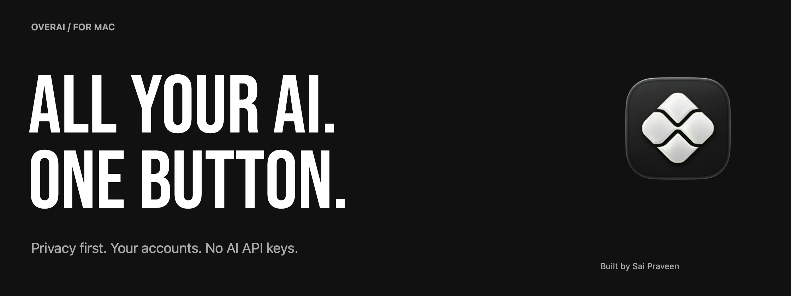
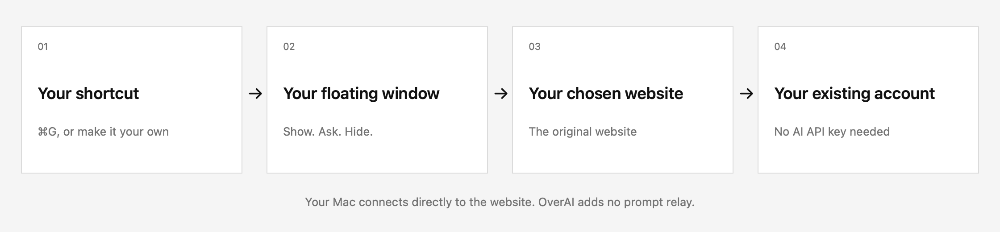
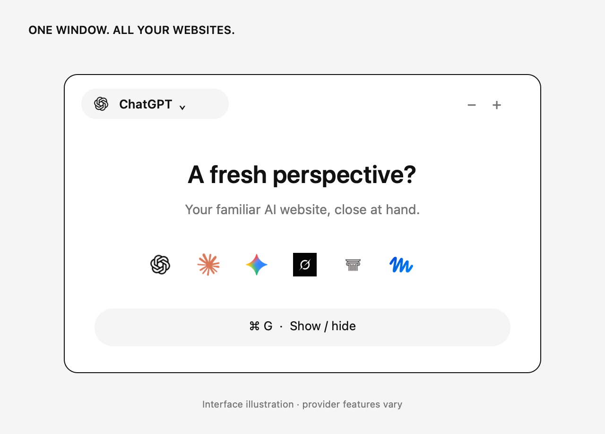
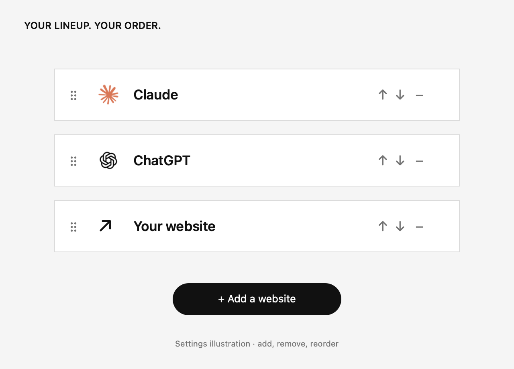

<p align="center">
  
</p>

<h1 align="center">OverAI</h1>
<p align="center"><strong>Your AI websites. One floating Mac window.</strong></p>
<p align="center">Switch between ChatGPT, Claude, Gemini, Grok, Arena, and your own websites.<br />Use your existing accounts. Keep your work in view. No AI API keys.</p>

<p align="center">
  
  
  
  
</p>

<p align="center">
  <a href="https://github.com/N-Saipraveen/overai-mac/releases/download/v3.0.1-beta.1/OverAI-3.0.1-3005-preview-arm64.dmg"><strong>↓ Download OverAI for Mac</strong></a>
  &nbsp; · &nbsp;
  <a href="https://n-saipraveen.github.io/overai-mac/">Explore the website ↗</a>
</p>
<p align="center"><sub>Apple Silicon (M1 or newer) · macOS 14+ · Free, without subscriptions or license keys.<br />The current preview is ad-hoc signed and <strong>not notarized by Apple</strong>. See the first-launch steps below.</sub></p>

<p align="center"><a href="#the-problem">Why OverAI</a> · <a href="#features">Features</a> · <a href="#install">Install</a> · <a href="#first-launch-on-macos">macOS help</a> · <a href="#visuals">Visuals</a> · <a href="#build-from-source">Build</a></p>

## The problem

Getting a little help from AI can turn into a lot of switching.

<table>
  <tr>
    <td width="33%" valign="top">
      <h3>Scattered websites</h3>
      <p>Your tools live in separate tabs and windows. Finding the right one interrupts what you were doing.</p>
    </td>
    <td width="33%" valign="top">
      <h3>Lost momentum</h3>
      <p>A quick question takes you away from your editor, document, or browser. Getting back adds another step.</p>
    </td>
    <td width="33%" valign="top">
      <h3>Too much on screen</h3>
      <p>A normal browser window can appear in a screen share. A private workspace needs more care.</p>
    </td>
  </tr>
</table>

## The solution

**OverAI brings your AI websites into one native floating window.** Call it up with a shortcut, choose a website, and get back to your work. It opens the original websites through Apple’s WebKit, using your existing accounts.

### How it works



1. **Call it up.** Press **⌘G** from any app, or choose your own shortcut.
2. **Pick your website.** Switch between built-in providers or websites you add.
3. **Use your account.** Sign in on the website as usual. No AI API key is required.
4. **Get back to work.** Press the shortcut again to hide the window.

Provider accounts, subscriptions, and usage limits still apply. OverAI does not unlock paid AI models. Online websites need an internet connection.

## Features

| Feature | What you get |
| --- | --- |
| **One AI selector** | ChatGPT, Claude, Gemini, Grok, and Arena in one window; Muse and custom websites are supported too. |
| **Your own lineup** | Add HTTPS websites, remove those you don’t use, and arrange them your way. |
| **A global shortcut** | **⌘G** by default. Change it in **Settings → General**. |
| **Capture protection** | Designed to exclude OverAI’s windows from supported recording and screen-sharing paths. Test your setup; compatibility varies. |
| **Persistent sign-ins** | Website sessions stay in OverAI’s local WebKit store. Providers may still expire sessions or restrict embedded sign-in. |
| **Window controls** | Adjust opacity with **− / +**, attach chosen files, and optionally enable microphone access. |
| **Native Mac app** | Swift, AppKit, and WebKit. Websites load when visited; retained pages still use memory. |
| **Free to use** | No OverAI subscription, account, license key, trial expiry, or payment verification. |

**Privacy:** OverAI adds no prompt logging, analytics, or prompt relay. Your selected websites process your content under their own policies. Safari and Chrome sessions are separate and aren’t imported. Capture protection cannot guarantee invisibility or hide system dialogs and external browser windows. [Read the privacy details →](https://n-saipraveen.github.io/overai-mac/privacy.html)

## Install


1. **[Download the Apple Silicon DMG](https://github.com/N-Saipraveen/overai-mac/releases/download/v3.0.1-beta.1/OverAI-3.0.1-3005-preview-arm64.dmg).** Open the downloaded file.
2. **Drag OverAI into Applications.** Wait for copying to finish, then eject the disk image. Updating? Quit OverAI first and choose **Replace** if asked.
3. **Open Applications → OverAI.** Choose **Show OverAI** or **Start Hidden**. Optional microphone setup can be skipped. If macOS blocks opening, follow the steps below.
4. **Press ⌘G.** Choose a website, sign in, and start using it. Change your shortcut in **Settings → General** and your lineup in **Settings → Websites**.

**Updating preserves your native-app website sessions.** Run the installed copy from Applications, rather than from the disk image.

[Full installation guide](https://n-saipraveen.github.io/overai-mac/install.html) · [Release notes & SHA-256 checksums](https://github.com/N-Saipraveen/overai-mac/releases/tag/v3.0.1-beta.1)

### First launch on macOS

This preview is **ad-hoc signed and not notarized by Apple**. If macOS says “Apple could not verify OverAI” or “developer cannot be verified,” only proceed with an official download you trust and have checked against its published checksum.

1. Try opening **OverAI in Applications** once. Close the warning with **Done** or **OK**.
2. Open **Apple menu → System Settings → Privacy & Security**.
3. Scroll to **Security**, find the message about OverAI, and click **Open Anyway**.
4. Authenticate if asked, then click **Open**. macOS saves the exception for future launches.

If **Open Anyway** is missing, try opening the app again and return to Privacy & Security. Managed Macs may prohibit exceptions; ask the administrator. [Apple’s first-launch guidance](https://support.apple.com/en-us/102445).

> If macOS reports malware, says OverAI **will damage your computer**, or reports a damaged/modified app, stop. Redownload the official release, check its checksum, and contact **hello@saipraveen.dev**. Do not bypass those warnings.

<details>
<summary><strong>Terminal fallback: the xattr method (advanced)</strong></summary>

Use this only for an official, checksum-verified OverAI preview you trust, already copied to `/Applications`. Prefer **Open Anyway** above.

First, check that the installed app’s bundled signature is intact:

```sh
codesign --verify --deep --strict --verbose=2 "/Applications/OverAI.app"
```

If verification fails, stop and download a fresh copy. An ad-hoc signature check confirms consistency, not the developer’s identity or absence of malware.

Then remove **only the quarantine attribute from OverAI** and open it:

```sh
xattr -dr com.apple.quarantine "/Applications/OverAI.app"
open "/Applications/OverAI.app"
```

This bypasses the quarantine-based first-launch check for this app. It does **not** notarize, scan, or repair it. The command is deliberately limited to one app: do not run it on your Downloads folder, all of Applications, or a disk. Do not disable Gatekeeper or use `xattr -cr` to clear every attribute. No `sudo` is included; if permission is denied, use the macOS approval flow or contact support instead.

If you installed OverAI somewhere else, use the exact path of your verified copy. “No such xattr” means that attribute is already absent; it does not indicate that the app is safe.

</details>

<details>
<summary><strong>How to check the download’s SHA-256</strong></summary>

Download `SHA256SUMS.txt` from the [same release](https://github.com/N-Saipraveen/overai-mac/releases/tag/v3.0.1-beta.1). In Terminal:

```sh
cd ~/Downloads
shasum -a 256 OverAI-3.0.1-3005-preview-arm64.dmg
```

Compare the complete 64-character result with the DMG line in `SHA256SUMS.txt`. They must match exactly. A checksum detects a changed download; it does not replace trust in the release source.

</details>

## Visuals

<table>
  <tr>
    <th width="50%">One window for your websites</th>
    <th width="50%">Your lineup, your order</th>
  </tr>
  <tr>
    <td></td>
    <td></td>
  </tr>
  <tr>
    <td>Switch websites and show or hide your window with a shortcut.</td>
    <td>Add your own websites and keep only the ones you want.</td>
  </tr>
</table>

<sub>Illustrations explain the interface; they are not screenshots of live accounts. Try the interactive preview on the <a href="https://n-saipraveen.github.io/overai-mac/#experience">website</a>.</sub>

## Tech stack

| Component | Technology | Purpose |
| --- | --- | --- |
| Native application | **Swift + AppKit** | Floating window, settings, menus, and macOS integration. |
| Website sessions | **WKWebView + WebKit** | Original websites with a persistent local website data store. |
| Global keyboard shortcut | **KeyboardShortcuts** | User-configurable show/hide shortcut. |
| Installer | **dmgbuild** | Reproducible DMG with Retina artwork and an Applications link. |
| Product website | **HTML, CSS, JavaScript + GitHub Pages** | Static site with local assets, no trackers, and an interactive illustration. |

Python is used for build tooling; it is **not** an app runtime. OverAI does not bundle a local model or install Ollama, Docker, or Open WebUI.

## Release checklist

- [x] Native Apple Silicon app with custom websites and shortcuts.
- [x] Free download without licensing or payment checks.
- [x] Visual installer and first-launch documentation.
- [x] 79 passing checks recorded for build 3005: core policy, native lifecycle/UI, capture, and cookie persistence.
- [ ] Developer ID signing and Apple notarization. **The current download remains an unnotarized preview.**

The checks use synthetic content and do not cover every provider or meeting-app combination. The release includes its build manifest and SHA-256 checksums.

## Project layout

```text
OverAI.xcodeproj/       Open in Xcode
Sources/
├── OverAI/
│   ├── App/           Entry point and app lifecycle
│   ├── Browser/       Website sessions, uploads, and provider artwork
│   ├── Settings/      Preferences and settings interface
│   ├── System/        Shortcuts, permissions, capture protection, diagnostics
│   ├── Windows/       Floating window and provider selector
│   └── Resources/     App icon, provider icons, and dependency notices
└── OverAICore/        Shared website and navigation policies
Tests/                 Core tests and native integration checks
Config/                App metadata, entitlements, and release version
website/               GitHub Pages product site
assets/                Installer artwork and README visuals
scripts/               Build, validation, and artwork tools
```

## Build from source

<details>
<summary><strong>Requirements, build commands, and validation</strong></summary>

Requires an Apple Silicon Mac, Xcode 26.3 / Swift 6.2+, and Python 3 for build tools. Open `OverAI.xcodeproj`, choose the **OverAI** scheme, and run.

To build the app and designed preview DMG:

```sh
python3 -m venv .venv
.venv/bin/python -m pip install -r scripts/requirements.txt
.venv/bin/python scripts/build.py --preview
```

Output is in `dist/`. `swift test` runs the core tests. `python3 scripts/build.py --test` also checks native lifecycle, UI, capture, and cookie persistence. Full validation needs an unlocked desktop and existing Screen Recording permission for the test app.

For notarized distribution, install a Developer ID Application identity and a `notarytool` Keychain profile. Set `OVERAI_SIGNING_IDENTITY`, then use `--release --notary-profile OVERAI_NOTARY`. Release mode requires signing, tests, notarization, and Gatekeeper checks.

Preview the website with `python3 -m http.server 4173 --directory website`; check links with `python3 scripts/check-website.py`. Regenerate this README’s artwork with `swift scripts/render-readme.swift`; installer artwork uses `swift scripts/render-artwork.swift`. Version information is in `Config/Release.json`.

</details>

## Acknowledgements

- [KeyboardShortcuts](https://github.com/sindresorhus/KeyboardShortcuts) for the global shortcut recorder and registration.
- [dmgbuild](https://github.com/dmgbuild/dmgbuild) for the installer tooling.
- [Bebas Neue](website/assets/fonts/OFL.txt) for the open-source display typeface.
- [Reach](https://github.com/dmunish/reach#readme) for the README layout inspiration.

Required dependency notices ship in [ThirdPartyNotices.txt](Sources/OverAI/Resources/ThirdPartyNotices.txt). Provider names and artwork belong to their owners. OverAI is independent and is not endorsed by Apple or the providers.

---

<p align="center"><strong>Built by <a href="https://github.com/N-Saipraveen">Sai Praveen</a>.</strong><br /><a href="mailto:hello@saipraveen.dev">hello@saipraveen.dev</a> · <a href="https://n-saipraveen.github.io/overai-mac/">Website</a> · <a href="https://github.com/N-Saipraveen/overai-mac/releases/latest">Download</a></p>
