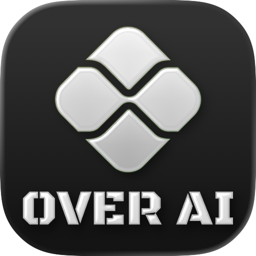

<p align="center"></p>

# OverAI for Mac

**Built by Sai Praveen.** Your AI websites in a native floating window. Press **⌘G**, choose a provider, and continue your conversation.

Built with Swift, AppKit and WebKit for **Apple Silicon Macs running macOS 14+**. ChatGPT, Claude, Gemini, Grok, Arena and Muse run as their original websites. No API keys, OverAI account, local model or intermediary server is required. Provider accounts and subscription limits still apply.

## Features

- Completely free: no subscription, purchase, trial expiry, license key, or payment verification.
- Floating, resizable window across Spaces and full-screen workspaces.
- Customizable global shortcut, with registration refreshed after wake.
- Original provider icons bundled locally; no network requests for selector artwork.
- Provider selector and toolbar options stay inside the capture-protected panel.
- Native navigation, minus/plus opacity controls, remembered position and settings.
- Lazy website loading and background CPU throttling. Visited pages stay alive to preserve drafts and responses when hiding or switching.
- Persistent WebKit cookies and website storage across normal launches.
- First-launch **Show OverAI / Start Hidden** choice, remembered for future launches and editable in Settings. Hidden startup defers the website page request until opened.
- First-launch microphone/files setup, with a skip option and controls in Settings. Microphone access uses the macOS consent prompt; upload-folder selection uses a native picker and a saved read-only bookmark. Nothing is recorded or uploaded during setup.
- Downloads, login windows, upload pickers, media permission handling and bounded renderer recovery.
- Arena starts at `https://arena.ai/text/direct?model_a=max`. Known Battle/side-by-side routes redirect to Direct, including in-page history navigation. Muse opens `https://muse.ai/`.
- Drop saved files, screenshot files, or supported screenshot promises on the **top toolbar** to attach through the current website's native file input. If the page creates its file input only after opening an attachment menu, open that menu first. Drops on the website itself remain under WebKit and the website's control. Upload/account/type/size limits still apply.

## Build

Requires an Apple Silicon Mac, Xcode 26.3 / Swift 6.2+, and Python 3 for development build helpers. The app itself is fully native and bundles no Python runtime or legacy Python application code.

```sh
python3 native/scripts/build.py --dmg --test
```

Output: `dist/OverAI.app`, `dist/OverAI-3.0.0-3004-local-arm64.dmg`, and its verification manifest. Local builds are not notarized.

Alternatively, open `native/OverAI.xcodeproj` and run the **OverAI** scheme. The checked-in project is relocatable; regenerate it with `python3 native/scripts/generate-project.py` after changing build settings. KeyboardShortcuts is pinned to 3.1.0; both package resolution files are included.

Local builds use ad-hoc signing. Developer ID signing and notarization are required for a normal distribution experience on other Macs. Use the gated `--release --notary-profile PROFILE` workflow with a Developer ID Application certificate. See [deployment instructions](docs/deployment.md).

The signed app includes microphone and camera capability entitlements. Microphone consent is offered after the first-launch startup choice; camera consent is requested only when used. The user approves permissions in macOS. Files remain limited to the folders/files the user chooses; this setup does not request Full Disk Access. A chosen upload folder becomes the starting location for website upload pickers, and can be forgotten or changed in Settings.

## Use

Quit the running app before opening an update. Drag the generated app to Applications. The native bundle identity stays `com.overai.native`, preserving its existing WebKit storage.

⌘G toggles the overlay, ⌘R reloads, ⌘, opens Settings, ⌘W/⌘H hides, and ⌘Q quits. Escape dismisses an open toolbar selector first, then hides the overlay by default. Change the global shortcut in Settings.

## Privacy and resource use

Requests go directly to the selected website. OverAI adds no analytics, prompt logging or account server. There is no licensing server or payment verification. Cookies stay in the app's persistent WebKit store; clearing website data requires confirmation. Providers can expire sign-ins, and some Google OAuth flows reject embedded browsers. Safari/Chrome sessions cannot simply be adopted by this WebView.

Capture exclusion is always requested using macOS compatibility APIs. The overlay stays hidden if exclusion cannot be enabled. **This is not a universal recording guarantee.** Verify the exact meeting app and sharing mode, especially Google Meet whole-screen sharing. System menus, website-owned native menus and external browser windows have separate ownership. See [validation](docs/native-validation.md).

Only selected or previously visited providers have WebViews; a hidden startup defers loading website content until the overlay opens. Their renderers still use memory; background throttling reduces CPU use but does not unload pages. Retaining a live page protects unsent drafts and running responses. Total RAM depends on the providers and workload; app disk size is not a RAM measurement. Drafts are not guaranteed to survive a renderer crash or a full quit.

## Source layout

| Path | Purpose |
| --- | --- |
| `native/Sources/OverAI` | AppKit application, WebKit sessions, protected overlay and settings |
| `native/Sources/OverAICore` | Provider registry and navigation/recovery policies |
| `native/Sources/OverAI/Resources` | App icon, official website icons and third-party notices |
| `native/Tests` | Core policy tests |
| `native/scripts` | Project generation, build, validation and packaging helpers |
| `docs` | Validation limits and product roadmap |

Generated builds, caches, validation screenshots and personal Xcode settings are excluded from Git. This repository contains no old Python application, virtual environment, browser profile or login-cookie export.

Provider artwork belongs to the respective providers. Attribution and asset source URLs are included with the resources. Dependency license text is in `native/Sources/OverAI/Resources/ThirdPartyNotices.txt`.

### UI and security review

Protected menus now support keyboard navigation and visible selection. Brief provider/menu fades respect macOS Reduce Motion. Delayed file drops and media approvals are tied to their original destination. See [review and validation boundaries](docs/ux-security-review.md).

### Your websites

Open **Settings → Websites** to add an HTTPS website with your own name, remove built-in or custom websites, and change their order with the up/down controls. Keep just one website if you prefer. The floating picker and menu bar follow your saved list across launches. Missing built-in websites can be restored without removing custom ones.

Removing a website closes its open page after confirmation, so save any draft first. Cookies and other saved website data remain until you clear website data in Privacy. Custom websites use a local globe icon and load only when selected; no favicon service or additional account is required. Some websites restrict embedded browsers. HTTP/local-server support and managed local-model runtimes are not included.

### Free public preview

[Download the Apple Silicon DMG](https://github.com/N-Saipraveen/overai-mac/releases/tag/v3.0.0-beta.1) · [Website](https://n-saipraveen.github.io/overai/)

Version 3.0.0 build 3004 is free with no license key. Provider accounts, paid plans, and usage limits remain separate.

This preview is ad-hoc signed and **not notarized by Apple**; macOS Gatekeeper may block it. It is labeled as a prerelease, not a notarized distribution release. The release includes SHA-256 checksums and a validation manifest. Build 3004 passed 79 automated checks. See [Apple’s guidance for opening apps safely](https://support.apple.com/en-us/102445). Do not disable system-wide security protections to install it.

Build the tested preview with `python3 native/scripts/build.py --preview`. For a Developer ID signed/notarized distribution, follow [deployment](docs/deployment.md).

The native Swift app replaces the older Python implementation; earlier history and releases are retained. The website is maintained separately in `N-Saipraveen/overai`.
