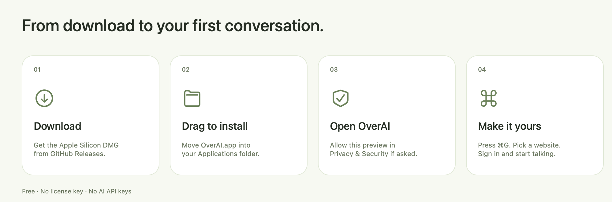

<p align="center"></p>
<h1 align="center">OverAI</h1>
<p align="center"><strong>All your AI. One button. Privacy first.</strong></p>
<p align="center">ChatGPT, Claude, Gemini, Grok, Arena, Muse, and your own websites.<br>One floating Mac window. Your existing accounts. No AI API keys.</p>
<p align="center"><a href="https://github.com/N-Saipraveen/overai-mac/releases/download/v3.0.1-beta.1/OverAI-3.0.1-3005-preview-arm64.dmg"><strong>↓ Download OverAI for Mac</strong></a></p>
<p align="center">Free · Apple Silicon (M1 or newer) · macOS 14 or later</p>
<p align="center"><a href="https://n-saipraveen.github.io/overai-mac/">Website</a> · <a href="#install-in-four-steps">Install</a> · <a href="#if-macos-blocks-the-first-launch">First-launch help</a> · <a href="https://github.com/N-Saipraveen/overai-mac/releases/tag/v3.0.1-beta.1">Release notes & checksums</a></p>

## Install in four steps



### 1. Download

**[Download the Apple Silicon DMG →](https://github.com/N-Saipraveen/overai-mac/releases/download/v3.0.1-beta.1/OverAI-3.0.1-3005-preview-arm64.dmg)**

No account, payment, license key, or API key is needed to install OverAI. The current preview is **not notarized by Apple**, so macOS may block its first launch. The steps below explain what to do.

### 2. Drag into Applications

Open the downloaded `.dmg`. In the installer window, **drag the OverAI icon onto the Applications folder**. Wait for copying to finish, then eject the OverAI disk image.

**Updating?** Quit your existing OverAI first, then choose **Replace** if Finder asks. Your native-app website sessions stay in place.

### 3. Open OverAI

Open **Finder → Applications → OverAI**. Run the copy in Applications, not the one inside the disk image. If macOS blocks it, use [the first-launch steps below](#if-macos-blocks-the-first-launch).

Choose **Show OverAI** or **Start Hidden**. You can change this later in Settings. Microphone setup is optional; you can skip it.

### 4. Press ⌘G

Press **Command-G** to show your window. Choose a website from the top bar, sign in with your existing account, and start using it. Press the shortcut again to hide OverAI.

Change the shortcut in **Settings → General**. Add, remove, and rearrange websites in **Settings → Websites**.

## If macOS blocks the first launch

This preview is ad-hoc signed, with **no Apple notarization**. A message such as “Apple could not verify OverAI” or “developer cannot be verified” is expected for this build. An exception lets the app open; it is not an Apple safety certification.

Only proceed if you downloaded the official release and trust it. The release includes `SHA256SUMS.txt` so you can check the DMG against the published hash.

**Use macOS’s built-in approval flow:**

1. Try opening **OverAI in Applications** once. Close the warning with **Done** or **OK**.
2. Open **Apple menu → System Settings → Privacy & Security**.
3. Scroll down to **Security**. Find the message about OverAI being blocked and click **Open Anyway**.
4. Authenticate with Touch ID or your Mac password if asked.
5. In the confirmation, click **Open**. Future launches should use the saved exception.

If **Open Anyway** is missing, try opening OverAI again and return to Privacy & Security. A managed work or school Mac may prohibit exceptions; ask its administrator. See [Apple’s current instructions](https://support.apple.com/en-us/102445).

> If macOS says OverAI **will damage your computer**, flags malware, or reports a damaged/modified app, stop. Redownload from the official release, verify its checksum, and contact **hello@saipraveen.dev**. Do not use a Terminal bypass to dismiss those warnings.

<details>
<summary><strong>Terminal fallback: the xattr method (advanced)</strong></summary>

Use this only for an official, checksum-verified OverAI preview you trust, already copied to `/Applications`. Prefer **Open Anyway** above.

First, check that the installed app’s bundled signature is intact:

```sh
codesign --verify --deep --strict --verbose=2 "/Applications/OverAI.app"
```

If verification fails, stop and download a fresh copy. An ad-hoc signature check confirms consistency, not the developer’s identity or absence of malware.

Then remove **only the quarantine attribute from OverAI** and open it:

```sh
xattr -dr com.apple.quarantine "/Applications/OverAI.app"
open "/Applications/OverAI.app"
```

This bypasses the quarantine-based first-launch check for this app. It does **not** notarize, scan, or repair it. The command is deliberately limited to one app: do not run it on your Downloads folder, all of Applications, or a disk. Do not disable Gatekeeper or use `xattr -cr` to clear every attribute. No `sudo` is included; if permission is denied, use the macOS approval flow or contact support instead.

If you installed OverAI somewhere else, use the exact path of your verified copy. “No such xattr” means that attribute is already absent; it does not indicate that the app is safe.

</details>

<details>
<summary><strong>How to check the download’s SHA-256</strong></summary>

Download `SHA256SUMS.txt` from the [same release](https://github.com/N-Saipraveen/overai-mac/releases/tag/v3.0.1-beta.1). In Terminal:

```sh
cd ~/Downloads
shasum -a 256 OverAI-3.0.1-3005-preview-arm64.dmg
```

Compare the complete 64-character result with the DMG line in `SHA256SUMS.txt`. They must match exactly. A checksum detects a changed download; it does not replace trust in the release source.

</details>

## Make it your own

| What you want | Where to find it |
| --- | --- |
| A different show/hide shortcut | Settings → General |
| Only the websites you use | Settings → Websites |
| Your websites in your order | Settings → Websites → move up/down |
| A quieter startup | Settings → General → Start Hidden |
| More or less window opacity | **− / +** in the top bar |
| To clear saved website data | Settings → Privacy |

**⌘G** shows/hides · **⌘R** reloads · **⌘,** opens Settings · **Esc** dismisses the selector or hides the window · **⌘Q** quits.

## Privacy comes built in

Your conversations connect directly to the selected website. OverAI adds no prompt logging, analytics, account server, or payment verification. Provider accounts, paid plans, usage limits, and privacy policies still apply.

Capture protection is requested for OverAI’s own windows. The overlay stays hidden if it cannot be enabled. Compatibility depends on macOS and your meeting or recording app: **test your setup before sharing sensitive content**. System dialogs and external browser windows are outside this protection.

Website sign-ins persist in OverAI’s local WebKit store, separate from Safari and Chrome. Providers may expire sessions or restrict embedded-browser sign-in. Websites load as you visit them; retained pages preserve their state and still use memory.

<details>
<summary><strong>For developers: build, test, and website</strong></summary>

Requires an Apple Silicon Mac, Xcode 26.3 / Swift 6.2+, and Python 3 for build tools. The app has no Python runtime. Open `OverAI.xcodeproj`, choose the **OverAI** scheme, and run.

For the designed DMG, install the packaging dependency in a local environment:

```sh
python3 -m venv .venv
.venv/bin/python -m pip install -r requirements-build.txt
.venv/bin/python scripts/build.py --preview
```

Output is in `dist/`. The open-source [dmgbuild](https://github.com/dmgbuild/dmgbuild) tool writes the installer’s background, icon positions, and Applications link. It is a build dependency only. Artwork can be regenerated with `swift scripts/render-artwork.swift`.

Run `swift test` for core tests. `python3 scripts/build.py --test` also checks native lifecycle, UI, capture, and cookie persistence. Full validation needs an unlocked desktop and existing Screen Recording permission for the test app; it uses synthetic content.

For a notarized distribution, install a Developer ID Application identity and a `notarytool` Keychain profile, then use `--release --notary-profile OVERAI_NOTARY` with `OVERAI_SIGNING_IDENTITY` set. That mode requires signing, tests, notarization, and Gatekeeper checks; the preview does not claim those distribution approvals.

```text
Sources/       Swift app, shared policies, resources
Tests/         Core and native integration checks
website/       GitHub Pages product site and installation help
assets/        Installer background artwork
scripts/       Build and artwork tools
```

Website styling follows the reference in `DESIGN.md`, with OverAI’s own branding and locally served Bebas Neue under its included [SIL Open Font License](website/assets/fonts/OFL.txt).

Preview the site with `python3 -m http.server 4173 --directory website`. Check links with `python3 scripts/check-website.py`. Version information is in `Release.json`.

KeyboardShortcuts is pinned through Swift Package Manager; its required notice ships in `Sources/OverAI/Resources/ThirdPartyNotices.txt`. Provider artwork belongs to its respective owners. OverAI is independent and is not endorsed by Apple or the AI providers.

</details>

---

Built by **[Sai Praveen](https://github.com/N-Saipraveen)** · **[hello@saipraveen.dev](mailto:hello@saipraveen.dev)**
